  

  
  
  

<table>
  <tr>
    <td width="52%" valign="top">
      
    </td>
    <td width="48%" valign="top">

### Hi, I'm Mayank 👋

I'm a **Software Engineer at Simform**, building Expo apps and Next.js web apps for fitness and health clients. I build the whole product: cross-platform **mobile apps** in React Native and Expo, **web frontends** in React and Next.js, and the **Node.js, Firebase and AWS** services behind them.

- 📱 **Mobile**: iOS and Android from the first screen to the store release, with EAS Build, EAS Update (OTA) and EAS Workflows
- 🖥️ **Frontend**: fast, accessible interfaces and dashboards in Next.js and TypeScript
- ⚙️ **Backend**: REST APIs, databases, payments and cloud functions
- 💳 **Payments**: Stripe, Razorpay, PayPal, and in-app subscriptions with RevenueCat
- ⌚ **Health data**: wearable vitals via Terra API and Junction, real-time voice with LiveKit
- 🤖 **AI and agentic coding**: Claude Code every day, with my own rules, skills, hooks and MCP servers (Expo, RevenueCat, Terra docs), plus Cursor and Copilot
- 🧑‍🏫 **Mentoring**: I mentor junior developers through pairing and code review

    </td>
  </tr>
</table>

## 🧰 Stack

  

## 💼 Experience

| When | Role | Company | Highlights |
| :-- | :-- | :-- | :-- |
| Sep 2025 – now | Software Engineer | Simform | A gym member app and a connected-health platform (Expo and Next.js): booking, body metrics and history graphs, wearables, an AI health coach, nutrition logging and RevenueCat memberships. I mentor a junior developer on each project |
| Feb 2023 – 2025 | Associate Software Engineer | Radixweb | Full-stack web, mobile and smart-TV client products across maritime, healthcare, digital art and insurance, delivered 100% on time |
| Jun – Jul 2022 | Android Developer Intern | BrainyBeam Technologies | Built an e-commerce Android app |

🎓 **B.E.**, Ahmedabad Institute of Technology

## 🚀 Selected work

These are client products under NDA, so the names are codenames. The [portfolio](https://mayankbhadeshiya.vercel.app/#work) has the details.

| Project | What it is | Built with |
| :-- | :-- | :-- |
| [FitCircle](https://mayankbhadeshiya.vercel.app/projects/fitcircle) | Gym member app: class booking, body metrics and history graphs, workouts, challenges | Expo, EAS, TypeScript, Redux Thunk |
| [Vitalis](https://mayankbhadeshiya.vercel.app/projects/vitalis) | Connected health: wearables, biological age, AI coach with voice, nutrition | Expo, Next.js, RevenueCat, Terra, LiveKit |
| [WellNest](https://mayankbhadeshiya.vercel.app/projects/wellnest) | Wellness platform for booking sessions with expert consultants | React, React Native, Node.js, MongoDB |
| [PetPass](https://mayankbhadeshiya.vercel.app/projects/petpass) | Pet travel health certificates: vet portal and admin panel | Wasp, OpenSaaS, PostgreSQL, Stripe |
| [CanvasCast](https://mayankbhadeshiya.vercel.app/projects/canvascast) | Art carousels streamed to phones and smart TVs | React Native, LG webOS, VIZIO, Astro |
| [VoyageLog](https://mayankbhadeshiya.vercel.app/projects/voyagelog) | Offline-ready noon reporting for vessel crews | Next.js, Node.js, PostgreSQL, AWS |

## 🏅 Certifications

  
  

## 🐍 Contributions

<picture>
  <source media="(prefers-color-scheme: dark)" srcset="https://raw.githubusercontent.com/MayankBhadeshiya/MayankBhadeshiya/output/github-snake-dark.svg" />
  
</picture>

Cards are generated by <code>npm run cards</code> (<a href="scripts/build-cards.mjs">scripts/build-cards.mjs</a>) with official logos from <a href="https://simpleicons.org">Simple Icons</a>. The snake is redrawn daily by a GitHub Action.
